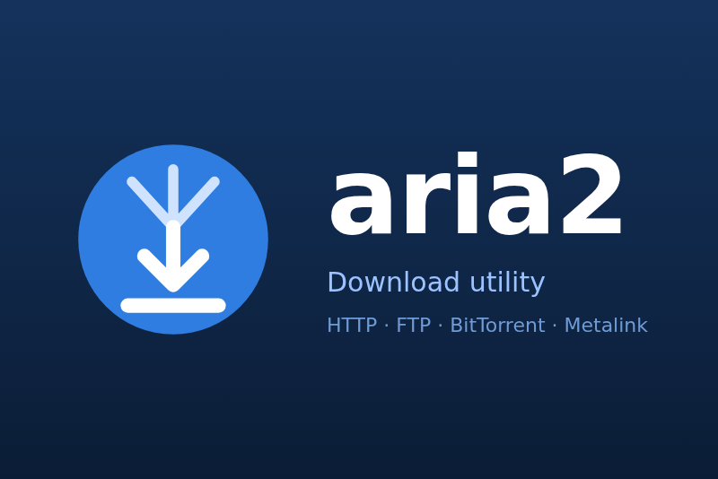

# aria2 for Gladys Assistant

A [Gladys Assistant](https://gladysassistant.com) external integration for
[aria2](https://aria2.github.io), the lightweight multi-protocol download
utility (HTTP, FTP, SFTP, BitTorrent, Metalink), over its JSON-RPC interface.



> **Tested on a real aria2 (1.37.0), not yet in a real home: feedback
> welcome** on the [Gladys forum](https://community.gladysassistant.com) or in
> the [issues](https://github.com/guim31/gladys-aria2/issues).

## What it does

- **One device**, aria2: download and upload speeds, active, waiting,
  completed and failed downloads, the current downloads with their
  percentage, the download speed limit, and whether aria2 answers.
- **Two switches**: _Pause all_ (pauses or resumes every download) and _Slow
  down_ (sets the download limit chosen in the configuration, or removes it).
- **Scene triggers**: _Download completed_ (name, size, folder), _Download
  failed_ (name, error message and code), _Nothing left to download_. They
  fire within a second, through the WebSocket notifications of aria2, and at
  the next reading without them.
- **Scene actions**: _Add a download link_ (http, https, ftp, sftp, magnet,
  .torrent or .metalink, optional folder), _Pause every download_, _Resume
  every download_, _Set the download speed limit_.
- **Dashboard widget** _aria2 downloads_: speeds, downloads in progress,
  counters, and the Pause all, Resume all and Slow down buttons.
- Texts and documentation in English, French, German and Spanish.

It never removes a download nor a file. The user documentation:
[English](docs/en.md), [français](docs/fr.md), [Deutsch](docs/de.md),
[español](docs/es.md).

## Requirements

- Gladys Assistant 5.1.0 or later.
- aria2 1.18 or later, reachable from Gladys, started with
  `--enable-rpc --rpc-listen-all` (port 6800) and preferably
  `--rpc-secret=<secret>`. AriaNg, Motrix, the `p3terx/aria2-pro` image and
  NAS packages all expose this RPC.

## Installation

1. In Gladys, open **Integrations → Install from GitHub** and enter
   `https://github.com/guim31/gladys-aria2` (or install it from the catalog).
2. In the configuration, enter the RPC address (`192.168.1.10:6800`, or the
   full `ws://…/jsonrpc` URL) and the RPC secret, then **Test the connection**.
3. In the **Discover** tab, add the aria2 device.

## How it works

The integration reads aria2 on its own timer (10 s to 2 min, 30 s by default)
with one `system.multicall` request (`getVersion`, `getGlobalStat`,
`getGlobalOption`, `tellActive`, `tellWaiting`, `tellStopped`), and again right
after each notification of the aria2 WebSocket (`aria2.onDownloadStart`,
`Pause`, `Stop`, `Complete`, `Error`, `onBtDownloadComplete`). The scene
events come from comparing two readings, so a lost notification is never a
lost event. Local API, no quota.

## Limits

- One aria2 server, one device (not one per download).
- The completed and failed counts are those of the aria2 session (they start
  again from zero when aria2 restarts).
- No removal of downloads or files, by design.

## Development

```bash
npm ci
npm test              # node --test, against an in-memory aria2
npm run lint
npm run format:check
npm run test:real     # a real aria2, with ARIA2_URL and ARIA2_SECRET (skipped otherwise)
```

`test/fixtures/aria2/` holds answers recorded from aria2 1.37.0 (anonymized).
See [CLAUDE.md](CLAUDE.md) for the architecture and the pitfalls found.

## Credits

- [aria2](https://github.com/aria2/aria2) by Tatsuhiro Tsujikawa and
  contributors (GPL-2.0): its
  [RPC documentation](https://aria2.github.io/manual/en/html/aria2c.html#rpc-interface).
- The architecture follows
  [guim31/gladys-torrent](https://github.com/guim31/gladys-torrent).
- Cover: a plain pictogram drawn for this repository (aria2 has no official
  logo).

Not affiliated with the aria2 project.

## License

[Apache-2.0](LICENSE).
